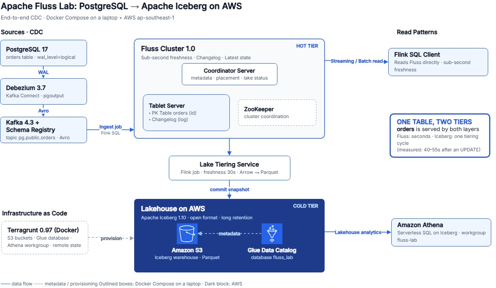

# Apache Fluss Lab: PostgreSQL to Apache Iceberg on AWS

Update a row in PostgreSQL, and a few seconds later the change is queryable in a streaming storage layer; within about a minute it shows up in Amazon Athena. This lab builds that end-to-end path on a laptop plus one AWS account: Debezium captures changes from Postgres, Kafka transports them, Flink writes them into Apache Fluss, and Fluss continuously tiers the data into Apache Iceberg tables on Amazon S3, registered in the AWS Glue Data Catalog and queried with Athena. Everything runs in Docker, including Terraform/Terragrunt and the AWS CLI.



> The editable source of the diagram is [`architecture.drawio`](architecture.drawio) (open it at [app.diagrams.net](https://app.diagrams.net)).

**Prerequisite knowledge**

- Basic SQL (`INSERT` / `UPDATE` / `SELECT`).
- Basic `docker compose` usage.
- An AWS account with permission to create an IAM user.

**What you get**

- A working Postgres → Iceberg CDC pipeline you can rebuild and tear down with a handful of commands.
- A row you can follow through every hop: Kafka topic, Fluss table, Iceberg table in Athena.
- A mental model: Fluss serves fresh data in seconds (hot tier), while the lake (Iceberg, cold tier) lags by one tiering cycle (30 seconds in this lab).

## Architecture

| Layer | Component | Role |
|---|---|---|
| Source | PostgreSQL 17 | `orders` table, `wal_level=logical` |
| CDC | Debezium 3.7 on Kafka Connect, Kafka 4.3, Schema Registry | Reads the WAL and publishes Avro change events to `pg.public.orders` |
| Hot tier | Apache Fluss 1.0 (coordinator + tablet server) | Primary-key table `orders`, sub-second reads of the latest state |
| Processing | Apache Flink 1.20 | Ingest job (Kafka → Fluss) and the Fluss Lake Tiering Service (Fluss → Iceberg) |
| Cold tier | Apache Iceberg 1.10 on S3, AWS Glue Data Catalog, Amazon Athena | Open table format, long retention, serverless SQL |

Key terms:

- **CDC** (change data capture): streaming every insert, update and delete out of a database.
- **WAL**: Postgres' write-ahead log. Debezium reads it to produce change events.
- **Fluss primary-key table**: keeps exactly one, always up-to-date row per `id`.
- **Tiering**: a Flink job that periodically copies Fluss data into Iceberg; each cycle commits a new Iceberg **snapshot**.
- **Terraform state**: the record of what Terraform created; this lab stores it in a dedicated S3 bucket.

All versions are pinned in [`versions.env`](versions.env): Postgres 17.10, Kafka 4.3.1, Debezium 3.7.0.Final, Fluss 1.0.0, Flink 1.20, Iceberg 1.10.1, Terraform 1.14.9, Terragrunt 0.97.2.

## Requirements

- **Docker**: Docker Desktop (Windows/macOS) or Docker Engine with Docker Compose v2.26 or later (Linux). Allocate about **12 GB RAM** and **15 GB disk** to Docker (Docker Desktop → Settings → Resources).
- **Shell**: bash (Linux/macOS) or PowerShell (Windows). On Windows use PowerShell, not Git Bash: Git Bash rewrites container paths such as `/opt/...` and `/lab/...` into Windows paths and the commands break.
- **AWS account**, default region **ap-southeast-1** (Singapore). Glue and Athena permissions in `iam-policy.json` are scoped to this region.
- No local Terraform, Terragrunt, AWS CLI or Java needed: they all run in containers.

## Step 1. IAM user and configuration (one-time)

1. AWS console → IAM → Users → Create user `fluss-lab`, without console access.
2. Add permissions → Create inline policy → JSON tab → paste [`iam-policy.json`](iam-policy.json). The policy only covers resources named `fluss-lab-*`, `fluss_lab`, `fluss-tfstate-*` and grants no IAM permissions.
3. Security credentials → Create access key → "Other". It must be a **long-term** key (starts with `AKIA`); temporary `ASIA…` keys (e.g. from SSO) make Fluss fail.
4. Create the two config files from the templates:

```bash
# bash
cp .env.example .env && cp .env.infra.example .env.infra && chmod 600 .env
```

```powershell
# PowerShell
Copy-Item .env.example .env; Copy-Item .env.infra.example .env.infra
```

5. In `.env`, set `AWS_ACCESS_KEY_ID` and `AWS_SECRET_ACCESS_KEY`, keep `AWS_REGION=ap-southeast-1`. In `.env.infra`, replace `<your-suffix>` in `LAB_BUCKET` and `TF_STATE_BUCKET` with lowercase letters and digits of your choice (S3 bucket names are globally unique). Keep the `fluss-lab-` and `fluss-tfstate-` prefixes.
6. Tell Docker Compose to load all three env files. Repeat in every new terminal:

```bash
# bash
export COMPOSE_ENV_FILES=versions.env,.env.infra,.env
export LAB_UID=$(id -u) LAB_GID=$(id -g)   # Linux: files Terragrunt writes under infra/ stay owned by you
```

```powershell
# PowerShell
$env:COMPOSE_ENV_FILES = "versions.env,.env.infra,.env"
```

`.env` and `.env.infra` are git-ignored. Never commit or share them. Avoid running `docker compose config` while screen sharing: it prints the access key.

From here on, every command runs from the repository root and is identical in bash and PowerShell unless noted.

## Step 2. Provision AWS resources with Terragrunt

Terragrunt runs inside the `infra` container (the `infra` profile in `docker-compose.yml`). This step creates the state bucket, the lab bucket, the Glue database `fluss_lab` and the Athena workgroup `fluss-lab`.

```bash
docker compose --profile infra build infra
# Create the state bucket (bootstrapping one unit is enough; all three share it)
docker compose --profile infra run --rm -w /lab/infra/lab/ap-southeast-1/glue infra backend bootstrap --non-interactive
# Apply all three units: s3, glue, athena
docker compose --profile infra run --rm infra run --all --non-interactive -- apply
```

Expected on the first run: `[s3] ... Resources: 6 added`, `[glue] ... 1 added`, `[athena] ... 1 added`. Terragrunt 0.97.2 does not create the state bucket during `apply`, hence the explicit `backend bootstrap`.

## Step 3. Start the local stack

```bash
docker compose build
docker compose up -d --wait
docker compose ps
```

The first build downloads several GB. When it finishes, 11 containers are `Up`: Postgres, Kafka, Schema Registry, Kafka Connect, kafka-ui, ZooKeeper, Fluss coordinator and tablet server, Flink jobmanager and taskmanager, AWS CLI. Web UIs: kafka-ui at http://127.0.0.1:8080, Flink UI at http://127.0.0.1:8083.

## Step 4. Register the Debezium connector

```bash
docker compose exec -T connect curl -s -X POST -H 'Content-Type: application/json' --data '@/opt/lab/register-postgres.json' http://localhost:8083/connectors
docker compose exec -T connect curl -s http://localhost:8083/connectors/pg-orders/status
```

The first command posts [`connect/register-postgres.json`](connect/register-postgres.json) to the Kafka Connect REST API. The second must report `"state":"RUNNING"`. In kafka-ui → Topics → `pg.public.orders` you should see 110 messages with `op = r` (Debezium's initial snapshot of the table).

## Step 5. Create the Fluss table, start tiering and ingestion

```bash
# 5.1 Primary-key table in Fluss with lake tiering enabled ('table.datalake.freshness' = '30s')
docker compose exec -T jobmanager /opt/flink/bin/sql-client.sh -i /opt/lab/sql/00-init.sql -f /opt/lab/sql/10-fluss-table.sql

# 5.2 Tiering job: Fluss -> Iceberg on S3, tables registered in Glue
docker compose exec -T jobmanager sh -c '/opt/flink/bin/flink run -d /opt/flink/opt/fluss-flink-tiering-1.0.0.jar --fluss.bootstrap.servers coordinator-server:9123 --datalake.format iceberg --datalake.iceberg.type glue --datalake.iceberg.warehouse s3://$LAB_BUCKET/iceberg-warehouse --datalake.iceberg.client.region $AWS_REGION --datalake.iceberg.io-impl org.apache.iceberg.aws.s3.S3FileIO'

# 5.3 Ingest job: Kafka topic -> Fluss table orders
docker compose exec -T jobmanager /opt/flink/bin/sql-client.sh -i /opt/lab/sql/00-init.sql -f /opt/lab/sql/20-ingest-job.sql

# 5.4 Check: two jobs must be RUNNING
docker compose exec -T jobmanager /opt/flink/bin/flink list -r
```

Command 5.2 is wrapped in single quotes so `$LAB_BUCKET` and `$AWS_REGION` expand **inside** the container; it runs unchanged in bash and PowerShell. Expected in 5.4: `Fluss Lake Tiering Service - iceberg (RUNNING)` and `fluss-ingest (RUNNING)`. If 5.1 fails to connect to `coordinator-server:9123`, Fluss is still starting: wait 10 seconds and retry.

## Step 6. Change data in Postgres, read it from Fluss

Open psql (prompt `shop=#`, exit with `\q`):

```bash
docker compose exec postgres psql -U lab -d shop
```

```sql
INSERT INTO orders VALUES (42, 'an', 120.00, 'new', now_ms());
UPDATE orders SET status = 'paid', updated_at_ms = now_ms() WHERE id = 42;
```

Open the Flink SQL Client in another terminal (set `COMPOSE_ENV_FILES` again, see step 1):

```bash
docker compose exec jobmanager /opt/flink/bin/sql-client.sh -i /opt/lab/sql/00-init.sql
```

```sql
SET 'execution.runtime-mode' = 'batch';
SELECT id, status, amount FROM orders WHERE id = 42;   -- 42 | paid | 120.00
```

Fluss reflects the update almost immediately. More checks are in [`sql/30-checks.sql`](sql/30-checks.sql). Avoid `SELECT COUNT(*) FROM orders` in batch mode: on a lake-enabled primary-key table, Fluss 1.0.0 fails with `lake records must instance of sorted view`.

## Step 7. Query the lake with Athena

Option 1, console: sign in to the AWS console → Athena → region **Asia Pacific (Singapore)** → Query editor → workgroup `fluss-lab`, database `fluss_lab` → run the queries in [`athena/queries.sql`](athena/queries.sql):

```sql
SELECT * FROM fluss_lab.orders WHERE id = 42;
SELECT COUNT(*) AS cnt, COUNT(DISTINCT id) AS ids, SUM(amount) AS total FROM fluss_lab.orders;
```

Athena only sees data that has been **tiered**. Right after the `UPDATE` it may still return the old value; in the author's run it matched after roughly 43–54 seconds. After step 6, `cnt` is 111 (110 seed rows plus order 42). The `"orders$snapshots"` query in the file shows one Iceberg snapshot per tiering cycle.

Option 2, AWS CLI in the `aws` container (uses the lab IAM user):

```bash
# bash
QID=$(docker compose exec -T aws aws athena start-query-execution --work-group fluss-lab --query-execution-context Database=fluss_lab --query-string "SELECT id, status, amount FROM orders WHERE id = 42" --query QueryExecutionId --output text | tr -d '\r')
sleep 5
docker compose exec -T aws aws athena get-query-results --query-execution-id "$QID" --query 'ResultSet.Rows[*].Data[*].VarCharValue' --output text
```

```powershell
# PowerShell
$QID = (docker compose exec -T aws aws athena start-query-execution --work-group fluss-lab --query-execution-context Database=fluss_lab --query-string "SELECT id, status, amount FROM orders WHERE id = 42" --query QueryExecutionId --output text).Trim()
Start-Sleep 5
docker compose exec -T aws aws athena get-query-results --query-execution-id $QID --query 'ResultSet.Rows[*].Data[*].VarCharValue' --output text
```

Try a delete: run `DELETE FROM orders WHERE id = 42;` in psql, then rerun the Athena query. After one tiering cycle, order 42 is gone.

## Step 8. Clean up

> **AWS cost.** While the stack runs, the tiering job writes to S3 every 30 seconds, so stop the stack after each session. The idle infrastructure (a near-empty bucket, a Glue database, a workgroup) costs close to nothing. A 3-hour session is estimated below USD 0.10 (not measured; verify with the [AWS Pricing Calculator](https://calculator.aws/)). The workgroup caps each query at 100 MiB scanned, and every resource is tagged `project=fluss-lab` for filtering in Billing.

Stop the local stack (also deletes local Postgres, Kafka and Fluss data):

```bash
docker compose down -v
```

Delete the AWS resources when you no longer need them. `destroy` removes the lab bucket (including its data), the Glue database and the Athena workgroup without asking again:

```bash
# The Glue table is created by Fluss, not managed by Terraform: delete it first
docker compose run --rm --no-deps --entrypoint aws aws glue delete-table --database-name fluss_lab --name orders
docker compose --profile infra run --rm infra run --all --non-interactive -- destroy
docker compose --profile infra down
```

The `fluss-tfstate-…` state bucket is kept (a few KB) so you can rebuild later. To remove it, only after a successful `destroy`: S3 console → select the bucket → Empty → Delete.

**Starting over** (after `down -v`, with the infrastructure still in place): Glue still holds the old `orders` table, so step 5.1 would fail with `Table already exists`. Reset the lake before repeating from step 3:

```bash
docker compose run --rm --no-deps --entrypoint aws aws glue delete-table --database-name fluss_lab --name orders
docker compose run --rm --no-deps --entrypoint sh aws -c 'aws s3 rm s3://$LAB_BUCKET/fluss-remote/ --recursive && aws s3 rm s3://$LAB_BUCKET/iceberg-warehouse/ --recursive'
```

## Troubleshooting

| Symptom | Fix |
|---|---|
| `versions.env not loaded` or `LAB_BUCKET missing in .env.infra` | `COMPOSE_ENV_FILES` is not set in this terminal, or `.env.infra` does not exist (step 1) |
| `AccessDenied` during Terragrunt | `iam-policy.json` not attached, or bucket names do not start with `fluss-lab-` / `fluss-tfstate-` |
| `InvalidBucketName` | `<your-suffix>` was not replaced in `.env.infra` |
| `BucketAlreadyExists` | The bucket name is taken: choose another suffix in `.env.infra` |
| Fluss fails to access S3 | Temporary `ASIA…` credentials or a session token in `.env`: use a long-term `AKIA…` key (step 1) |
| Port 8080/8081/8083 already in use | Change `KAFKA_UI_PORT`, `SCHEMA_REGISTRY_PORT`, `FLINK_UI_PORT` in `.env` |
| No table or snapshot in Athena | The tiering job is not running or failing: Flink UI → job → Exceptions; `docker compose logs taskmanager` |

## Repository layout

```text
docker-compose.yml     12 services; ports bound to 127.0.0.1 only; "infra" profile for Terragrunt
versions.env           every image and jar version
.env.example           template for .env (access key, ports, optional mirrors)
.env.infra.example     template for .env.infra (the two S3 bucket names)
iam-policy.json        least-privilege policy for the lab IAM user
architecture.drawio    architecture diagram source
postgres/init.sql      orders table, REPLICA IDENTITY FULL, 110 seed rows
connect/               Kafka Connect + Debezium + Avro converter; register-postgres.json
fluss/, flink/         Dockerfiles adding Glue/Kafka/Avro jars (checksum-verified)
sql/                   Fluss catalog, orders table, ingest job, manual checks
athena/queries.sql     Athena queries for the console
infra/                 Terragrunt: root.hcl (S3 backend), _envcommon/, modules/, lab/ap-southeast-1/{s3,glue,athena}
```

## License

Apache-2.0, see [`LICENSE`](LICENSE).
